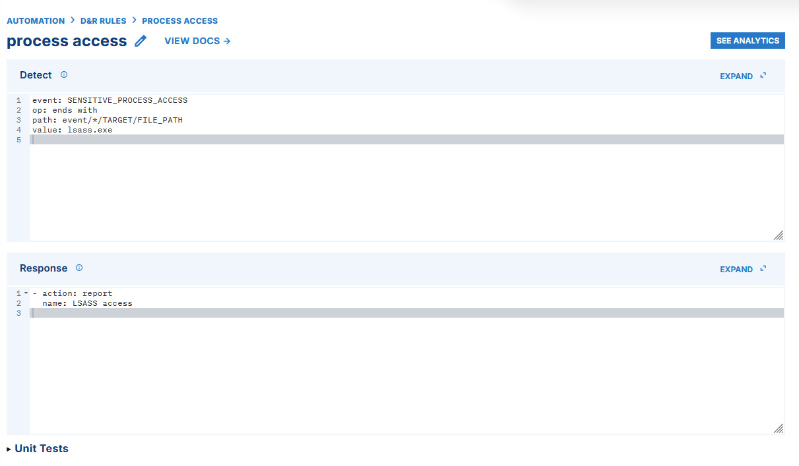

# SOC Homelab: Detecting LSASS Access with LimaCharlie

I built a two-VM lab to practice the full detection loop: generate controlled activity on a Windows endpoint, inspect the resulting telemetry, write a detection, and verify that an alert reaches a downstream destination. The lab was completed in August 2026 and follows the [Simply Cyber / Eric Capuano homelab]([(https://www.youtube.com/watch?v=P_Kl2EnF8_A)]), with my setup and results documented below.

**What I demonstrated:** A LimaCharlie rule alerted on access to `lsass.exe` during two controlled tests: activity initiated through a Sliver session and a separate PowerShell/ProcDump test. I also forwarded a detection event to a webhook endpoint and inspected the event payload.

## Lab environment

| Component | Role |
| --- | --- |
| VirtualBox NAT network | Connected the lab VMs; both were assigned static addresses after initial connectivity testing. |
| Windows 11 VM | Test endpoint with Sysmon, a custom Sysmon configuration, and a LimaCharlie sensor. |
| Ubuntu Server VM | Controlled attack VM running Sliver; accessed from the host over forwarded SSH. |
| LimaCharlie | Collected endpoint telemetry and ran the detection and response rule. |
| Webhook.site | Received a forwarded detection event for inspection. |

```text
Ubuntu Server VM (Sliver) ── lab network ──> Windows 11 VM
                                              │
                                      Sysmon + LimaCharlie sensor
                                              │
                                              v
                                    LimaCharlie D&R rule
                                              │
                                              v
                                      Detection / webhook
```

I used the [SwiftOnSecurity Sysmon configuration](https://github.com/SwiftOnSecurity/sysmon-config) as a starting point for Windows event collection. The full [46-page lab write-up](SOC%20Homelab%20Write%20Up.pdf) includes setup screenshots and the sequence of tests.

## Detection workflow

1. **Prepare the endpoint.** I installed Sysmon with a custom configuration, confirmed that Windows events were available with `Get-WinEvent`, then installed a LimaCharlie sensor and configured collection for Sysmon events.
2. **Generate test activity.** I transferred and ran a Sliver implant in the lab, confirmed its process and session in LimaCharlie, and used the session to generate access to a sensitive process.
3. **Investigate the signal.** LimaCharlie reported a `SENSITIVE_PROCESS_ACCESS` event. I inspected the event's source and target process fields and used the target path to build a specific rule for `lsass.exe`.
4. **Write and validate the rule.** The rule produced an **“LSASS access”** detection. I then ran a separate PowerShell/ProcDump test and observed the same detection, with PowerShell and ProcDump activity visible in the event data.
5. **Check delivery.** I configured a LimaCharlie webhook output and inspected the forwarded detection event in Webhook.site.

The detection condition shown in my lab was:

```yaml
event: SENSITIVE_PROCESS_ACCESS
op: ends with
path: event/*/TARGET/FILE_PATH
value: lsass.exe
```

The response used LimaCharlie's `report` action with the name `LSASS access`. This is a path-based lab rule; it does not by itself prove credential theft or identify whether process access was malicious.

## Evidence



The [detection log](assets/lsass-detection-events.jpg) shows `LSASS access` alongside related ProcDump detections in the test run. The [forwarded event payload](assets/webhook-detection-event.jpg) shows the source process and `lsass.exe` target received through the webhook output.


## Tools and source material

VirtualBox · Windows 11 · Ubuntu Server · Sysmon · LimaCharlie · Sliver · PowerShell · Sysinternals ProcDump · Webhook.site

This project follows the [Simply Cyber / Eric Capuano tutorial]([https://www.youtube.com/watch?v=P_Kl2EnF8_A])). The [original PDF write-up](SOC%20Homelab%20Write%20Up.pdf) preserves the full lab record and screenshots.

This is based on the home lab done on the Simply Cyber YouTube page with Eric Capuano.

Key things used:

- VirtualBox
- Windows 11 victim VM
- Linux attack VM
- Sysmon (custom XML config)
- LimaCharlie sensor + collection rules
- Sliver-Server C2 (payload deployment)
- PowerShell + Windows CMD/Registry tooling
- SSH/PuTTY + basic Linux networking/port setup
- Webhook-style detection for HTTP POST communications
